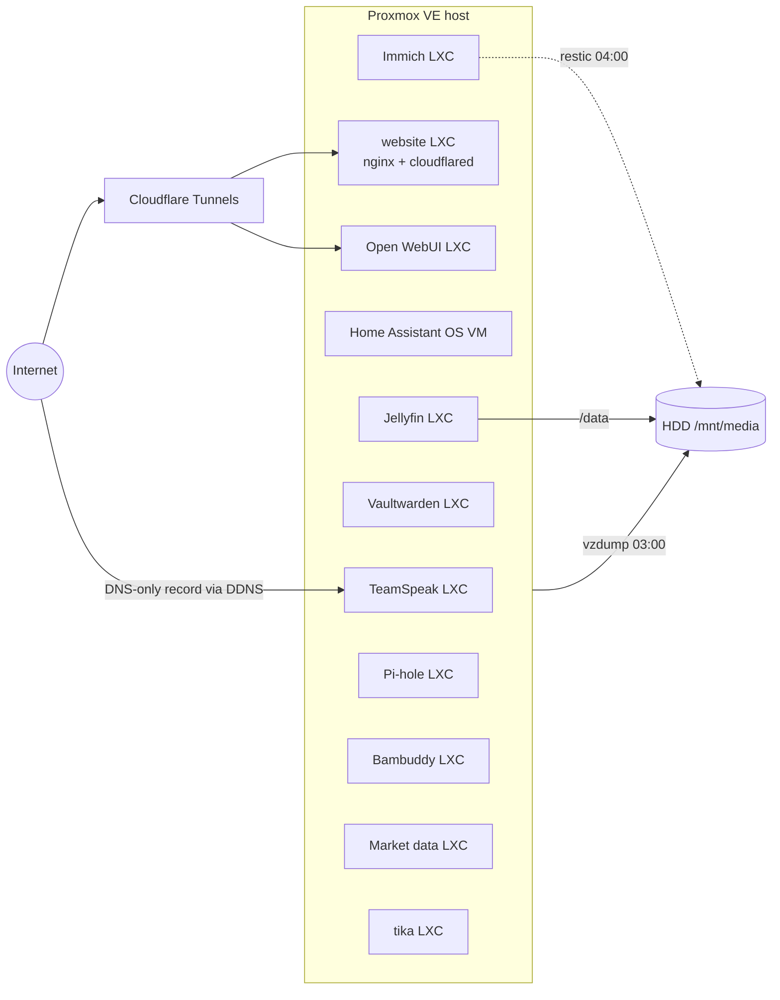

# Homelab

Configuration and documentation of my self-hosted services on a single Proxmox VE node.

> All secrets, tokens and internal addresses have been removed. Internal IPs appear as `192.168.x.x`,
> secrets as `${VARIABLES}`. See the `.env.example` file in each folder for what is required.

## Architecture



Detailed notes: [`docs/architecture.md`](docs/architecture.md)

## Services

| Service | Runs as | Purpose | Config |
|---|---|---|---|
| nginx + cloudflared | LXC | Website | [`services/website/`](services/website/) |
| Immich | LXC + Docker | Photo library | [`services/immich/`](services/immich/) |
| Vaultwarden | LXC + Docker | Password manager, TLS certificate via Tailscale | [`services/vaultwarden/`](services/vaultwarden/) (cert renewal only) |
| TeamSpeak 6 | LXC + Docker | Voice server with Cloudflare DDNS | [`services/teamspeak/`](services/teamspeak/) |
| Bambuddy | LXC + Docker | Bambu Lab 3D printer management | [`services/bambuddy/`](services/bambuddy/) |
| Open WebUI | LXC + Docker | LLM chat UI against an OpenAI-compatible API, own Cloudflare Tunnel | [`services/open-webui/`](services/open-webui/) |
| Market data collector | LXC + systemd | Collects Binance klines, backtest scripts | [`services/marketdata/`](services/marketdata/) |
| Jellyfin | LXC | Media server, `/dev/dri/renderD128` passed through | [`proxmox/lxc/101.conf`](proxmox/lxc/101.conf) |
| Pi-hole | LXC | DNS filtering | [`proxmox/lxc/100.conf`](proxmox/lxc/100.conf) |
| tika | LXC | no service config exported | [`proxmox/lxc/113.conf`](proxmox/lxc/113.conf) |
| Home Assistant | VM (HAOS) | Home automation | [`proxmox/qemu/109.conf`](proxmox/qemu/109.conf) |

Proxmox host configs (network, storage, backup job, all guest configs): [`proxmox/`](proxmox/)

## Backups

| What | How | When | Retention |
|---|---|---|---|
| All guests | `vzdump`, snapshot mode, zstd, to `/mnt/media/pve-backup` | daily 03:00 ([`proxmox/jobs.cfg`](proxmox/jobs.cfg)) | 7 daily, 4 weekly, 3 monthly |
| Immich library (files, no database dump) | `restic` on the Proxmox host to `/mnt/media/backup/immich` | daily 04:00, `Persistent=true` ([`scripts/backup/systemd/`](scripts/backup/systemd/)) | 7 daily, 4 weekly, 6 monthly |

Both backups go to the same disk mounted at `/mnt/media`. Script: [`scripts/backup/backup-immich.sh`](scripts/backup/backup-immich.sh)

## Maintenance

`lxc-update-all` runs on the host every Sunday at 05:00 ([`proxmox/crontab.txt`](proxmox/crontab.txt)).

## Repo structure

```
.
├── docs/                 architecture notes, writeup drafts
├── hardware/rack-sensor/ (empty)
├── home-assistant/       (empty)
├── proxmox/              host network/storage/backup config, LXC + VM configs
├── scripts/backup/       restic backup of Immich + systemd units
└── services/             compose files, systemd units and configs per service
```
