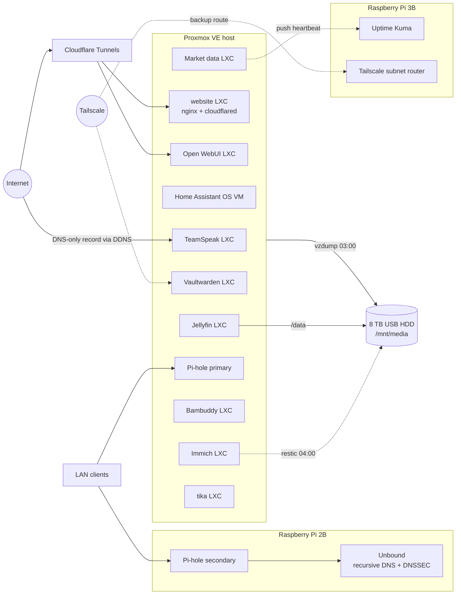
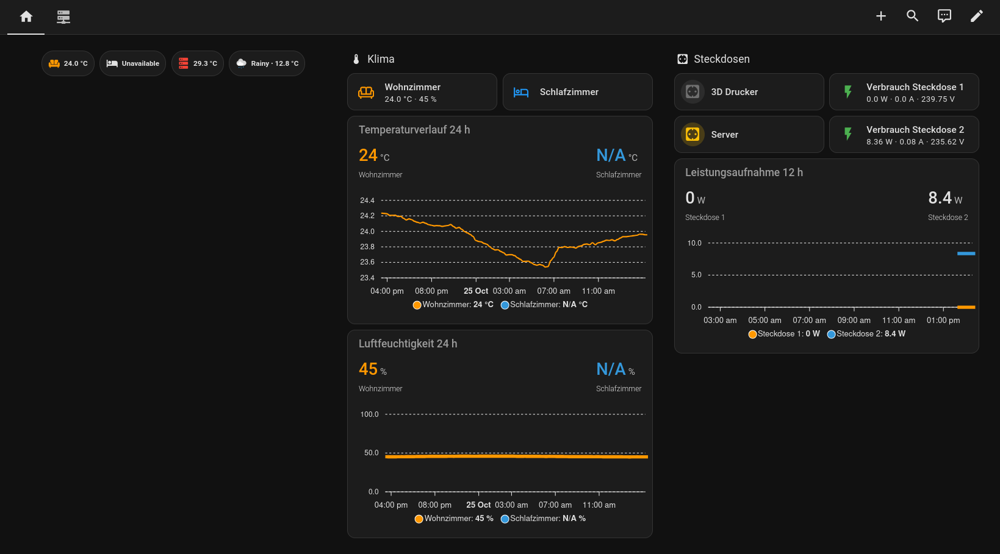
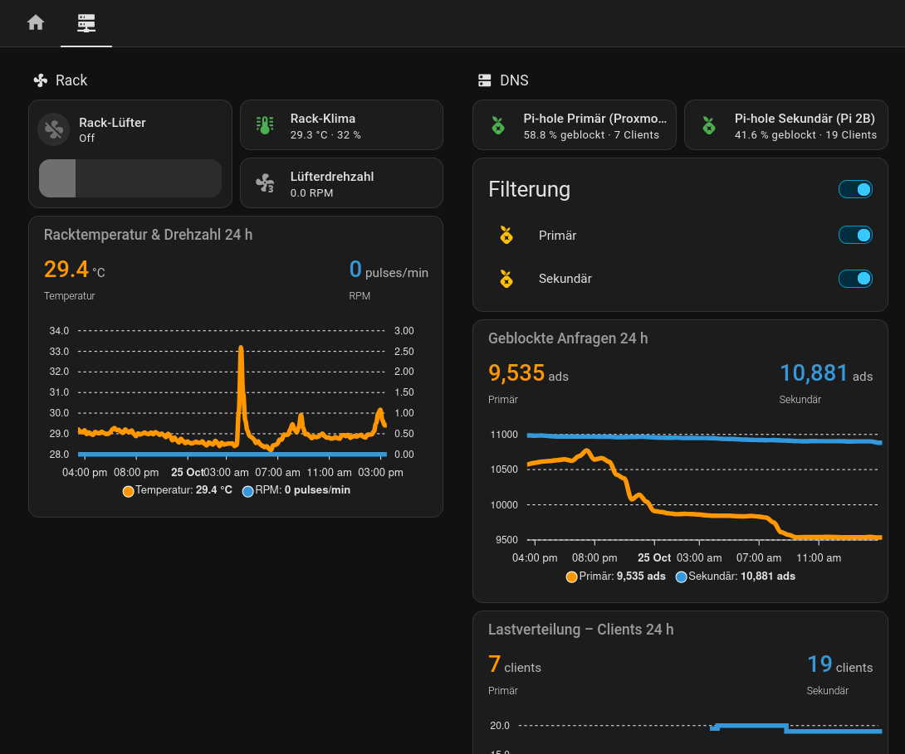

# Homelab

Self-hosted infrastructure running on a single Proxmox VE node and two Raspberry Pis in a 3D-printed 10-inch rack.

> All secrets, tokens and internal addresses have been removed. Internal IPs appear as `192.168.x.x`,
> secrets as `${VARIABLES}`. See the `.env.example` file in each folder for what is required.

## Hardware

| Device | Specs | Role |
|---|---|---|
| HP Mini PC | Intel i5 (6th gen), 16 GB RAM, 2 TB SSD | Proxmox VE host |
| Raspberry Pi 3B | Docker | Uptime Kuma, Tailscale backup subnet router |
| Raspberry Pi 2B | – | Secondary Pi-hole + Unbound |
| External USB HDD | 8 TB, ext4, mounted at `/mnt/media` | Media storage and backup target |
| TP-Link switch | – | Rack networking |
| Rack | Lab Rax 10" 5U, 3D-printed | Housing |

## Architecture



Detailed notes: [`docs/architecture.md`](docs/architecture.md)

## Services

| Service | Runs as | Purpose | Config |
|---|---|---|---|
| nginx + cloudflared | LXC | Website | [`services/website/`](services/website/) |
| Immich | LXC + Docker | Photo library | [`services/immich/`](services/immich/) |
| Vaultwarden | LXC + Docker | Password manager, reachable via Tailscale with a `tailscale cert` TLS certificate | [`services/vaultwarden/`](services/vaultwarden/) |
| TeamSpeak 6 | LXC + Docker | Voice server with Cloudflare DDNS | [`services/teamspeak/`](services/teamspeak/) |
| Bambuddy | LXC + Docker | Bambu Lab 3D printer management | [`services/bambuddy/`](services/bambuddy/) |
| Open WebUI | LXC + Docker | LLM chat UI against an OpenAI-compatible API, own Cloudflare Tunnel | [`services/open-webui/`](services/open-webui/) |
| Market data pipeline | LXC + systemd | Collects Binance klines, backtesting framework; code in its own repository: [marketdata-pipeline](https://github.com/robinw0410/marketdata-pipeline) | [`services/marketdata/`](services/marketdata/) |
| Deal search | LXC | Runs [deal-engine](https://github.com/robinw0410/deal-engine), a self-hosted engine for second-hand deals | [`services/deal-search/`](services/deal-search/) |
| Jellyfin | LXC | Media server, `/dev/dri/renderD128` passed through | [`proxmox/lxc/101.conf`](proxmox/lxc/101.conf) |
| Pi-hole primary | LXC | DNS filtering | [`proxmox/lxc/100.conf`](proxmox/lxc/100.conf) |
| Pi-hole secondary + Unbound | Raspberry Pi 2B | Redundant DNS filtering, recursive DNS with DNSSEC | – |
| Uptime Kuma | Docker on Pi 3B | Service monitoring | – |
| Tailscale subnet router | Raspberry Pi 3B | Backup route into the LAN | – |
| tika | LXC | no service config exported | [`proxmox/lxc/113.conf`](proxmox/lxc/113.conf) |
| Home Assistant | VM (HAOS) | Home automation | [`proxmox/qemu/109.conf`](proxmox/qemu/109.conf) |

Proxmox host configs (network, storage, backup job, all guest configs): [`proxmox/`](proxmox/)

## Backups

| Time | What | How | Retention |
|---|---|---|---|
| 02:00 | Immich database | Immich's built-in DB dump into `/mnt/pve/storage/immich-data/backups` | 14 dumps |
| 03:00 (done ~03:20) | All guests | `vzdump`, snapshot mode, zstd, to `/mnt/media/pve-backup` ([`proxmox/jobs.cfg`](proxmox/jobs.cfg)) | 7 daily, 4 weekly, 3 monthly |
| 04:00 | Immich library incl. database dumps | `restic` on the Proxmox host to `/mnt/media/backup/immich` ([`scripts/backup/`](scripts/backup/)) | 7 daily, 4 weekly, 6 monthly |

The jobs run one after another without overlapping. vzdump and restic both write to the 8 TB USB HDD.

## Maintenance

`lxc-update-all` runs on the host every Sunday at 05:00 ([`proxmox/crontab.txt`](proxmox/crontab.txt)).

## Home Assistant dashboard

Lovelace dashboard in the sections layout with two views. Config: [`home-assistant/dashboard.yaml`](home-assistant/dashboard.yaml)

| View | Sections |
|---|---|
| **Zuhause** (home) | Status chips (room and rack temperature, weather) · Klima: living room and bedroom with 24 h temperature and humidity charts · Steckdosen: two Sonoff smart plugs (3D printer, server) with power, current, voltage and a 12 h power chart · Staubsauger: robot vacuum controls, status and map |
| **Server** | Rack: fan, temperature/humidity, fan RPM, 24 h chart · DNS: both Pi-holes with block rate, clients, filter switches, blocked queries and client distribution · Verfügbarkeit: all Uptime Kuma monitors · Proxmox node: status, uptime, CPU, RAM, 24 h chart, restart/shutdown buttons · Container & VMs: status of all guests · Speicher: usage of `storage`, `local-lvm`, `local` with a 30-day chart |

HACS frontend cards:

- [Mushroom](https://github.com/piitaya/lovelace-mushroom): chips, template, entity, fan and vacuum cards
- [ApexCharts Card](https://github.com/RomRider/apexcharts-card): all history charts
- [auto-entities](https://github.com/thomasloven/lovelace-auto-entities): Uptime Kuma monitors (`integration: uptime_kuma`) and Proxmox guests (`integration: proxmoxve`) are listed automatically

Entity IDs are from my instance; the Sonoff device IDs are replaced with `sonoff_DEVICE_ID_1` / `_2`.

| Zuhause | Server |
|---|---|
|  |  |

## Hardware projects

| Device | Hardware | Status | Folder |
|---|---|---|---|
| Rack fan controller | diymore ESP32, SHT31-D, Noctua NF-P12 redux-1700 PWM, ESPHome | Deployed: measures rack temperature/humidity, drives the fan along a curve with hysteresis and a failsafe | [`hardware/rack-fan/`](hardware/rack-fan/) |
| Room sensor | diymore ESP32, SHT31-D in a 3D-printed case, ESPHome | Deployed in the living room | [`hardware/room-sensor/`](hardware/room-sensor/) |

## Repo structure

```
.
├── docs/                 architecture notes, writeup drafts, screenshots
├── hardware/
│   ├── rack-fan/         ESPHome rack fan controller
│   └── room-sensor/      ESPHome room sensor + enclosure STL
├── home-assistant/       Lovelace dashboard YAML
├── proxmox/              host network/storage/backup config, LXC + VM configs
├── scripts/backup/       restic backup of Immich + systemd units
└── services/             compose files, systemd units and configs per service
```
